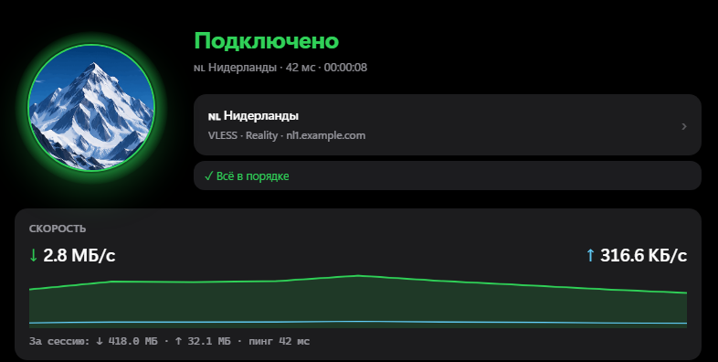
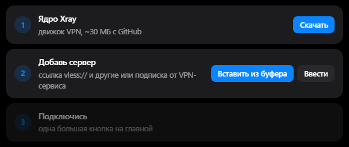

  

<h1 align="center">rxvpn</h1>

  <a href="README.md">Русский</a> · <b>English</b>

  <b>A private connection — with one button.</b> 
  A Windows client: your own servers, smart routing and leak protection.

  <a href="https://github.com/rxsk7/rxVPN/releases/latest"><b>⬇ Download the latest version</b></a>

  

## Features

**Connecting**
- Modern protocols: **VLESS + Reality**, xHTTP, VMess, Trojan, Shadowsocks, **Hysteria2**, **TUIC** (via sing-box).
- Subscriptions from Marzban, Remnawave, 3x-ui and any VPN provider — with remaining traffic and expiry date.
- **⚡ Auto** picks the fastest stable server and switches if it goes down.
- Modes: **Browser** (system proxy), **Whole PC** (TUN — games and any app) and **No VPN**.
- **Mini window by the clock**, the **Ctrl+Alt+V** hotkey and auto-connect when you start a chosen program (Discord, a game).
- A server stops answering over one protocol — rxvpn tries the same server over another (say, Hysteria2 instead of VLESS).

**Routing and network**
- **Split routing**: local sites go direct, the rest through your server. Custom rules for sites and apps.
- **Connection tuning** for specific services ([zapret](https://github.com/bol-van/zapret)) — uses no server traffic.
- **Built-in Telegram proxy** with one switch.
- **Network diagnostics** — in 10 seconds shows why a site won't open and suggests a fix.
- **Unstable mobile networks** — rxvpn finds a server it can still reach, or helps you chain two of your own servers.

**Protection**
- **Kill switch**: if the VPN drops, the internet closes — no app reaches the network with your real IP.
- Tamper-free DNS, leak checks for IP, DNS and IPv6.
- **Your own server in five minutes**: give rxvpn your VPS address and password — it sets everything up and hardens it.
  Give friends access: a QR code, a GB cap and an expiry date per friend — the server cuts them off by itself.
- **Traffic by program**: see which app eats your subscription's data cap.
- Signed updates, server passwords encrypted with your Windows account key, no telemetry.

## Getting started

1. [Download](https://github.com/rxsk7/rxVPN/releases/latest) `rxvpn-portable-*.zip` and unpack it anywhere — `D:\rxvpn`, the desktop, a USB stick. Just not into `Program Files`.
2. Run `rxvpn.exe`. Windows may show “Windows protected your PC” — the app isn't code-signed yet: **More info → Run anyway**.
3. Paste a server link or subscription → press the mountain. Done.

  

rxvpn is **portable**: everything lives in the `data` folder next to it. Move it to another PC by copying the folder (or a backup); remove it by deleting the folder. Updates arrive by themselves: once a day rxvpn checks for a new version and installs it on your click — only if the signature matches.

The interface is in Russian and English; it follows your Windows language, or pick one in Settings.

## FAQ

**My antivirus flags zapret.** Windows Defender labels the WinDivert driver a “hacktool”. rxvpn downloads only the official zapret and checks it by hash. If Defender removes the files, add the `data\zapret` folder to exclusions.

**Why administrator rights?** Only for Whole PC mode, zapret and tamper-free DNS — they change networking for the whole computer. Browser mode works without them.

**Can rxvpn see my traffic?** No. The protocols encrypt traffic themselves; rxvpn collects nothing and sends nothing anywhere.

**Where do I get a server?** Your own VPS from any host (rxvpn sets it up) or a subscription from a service you trust.

## For developers

Rust (all logic) + Tauri 2 (window) + [Xray-core](https://github.com/XTLS/Xray-core) (protocols). Architecture, building, tests and security details (in Russian) — [docs/DEVELOPMENT.md](docs/DEVELOPMENT.md).

## License and thanks

rxvpn is licensed under [GPL-3.0](LICENSE).

[Xray-core](https://github.com/XTLS/Xray-core) (MPL-2.0) · [sing-box](https://github.com/SagerNet/sing-box) (GPL-3.0) · [zapret](https://github.com/bol-van/zapret) and [Flowseal strategies](https://github.com/Flowseal/zapret-discord-youtube) (MIT) · [tg-ws-proxy](https://github.com/Flowseal/tg-ws-proxy) (MIT) · [Arti](https://gitlab.torproject.org/tpo/core/arti) · [runetfreedom routing lists](https://github.com/runetfreedom/russia-v2ray-rules-dat) · [Wintun](https://www.wintun.net/)
