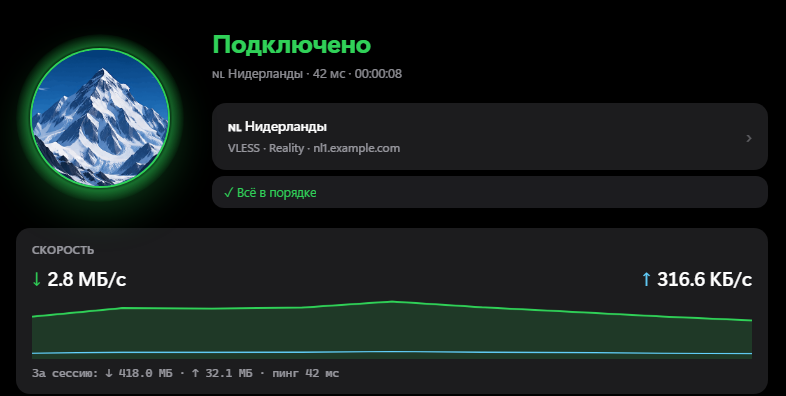
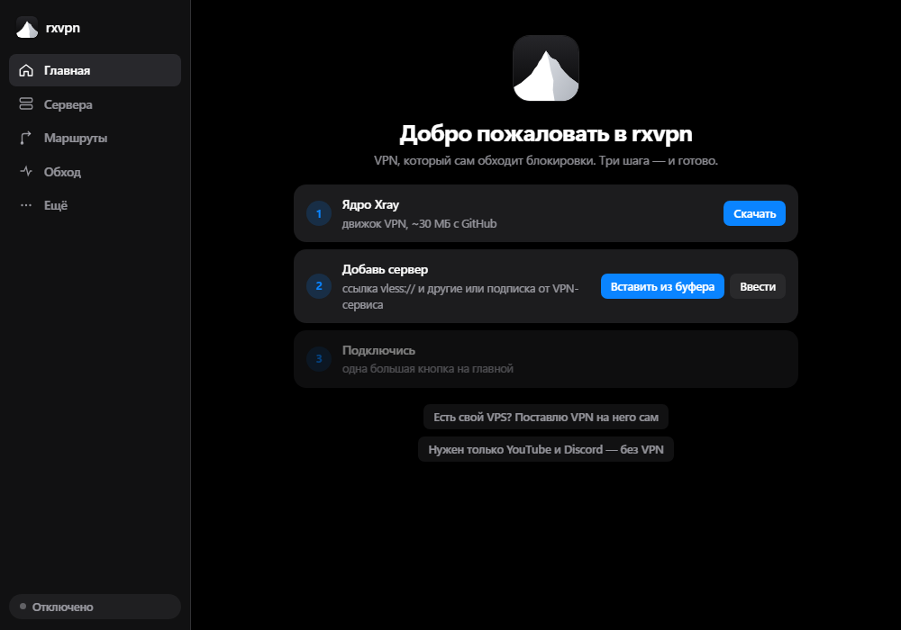

  

<h1 align="center">rxvpn</h1>

  <b>Русский</b> · <a href="README.en.md">English</a>

  <b>Интернет без блокировок — одной кнопкой.</b> 
  VPN-клиент для Windows, который сам обходит блокировки.

  <a href="https://github.com/rxsk7/rxVPN/releases/latest"><b>⬇ Скачать последнюю версию</b></a>

  

## Что умеет

**Подключение**
- Все современные протоколы: **VLESS + Reality**, xHTTP, VMess, Trojan, Shadowsocks, **Hysteria2**.
- Подписки от Marzban, Remnawave, 3x-ui и любых VPN-сервисов — с остатком трафика и сроком.
- **«⚡ Авто»** — сам выбирает самый быстрый и стабильный сервер и переключается, если тот упал.
- Режимы: **«Браузер»** (системный прокси), **«Весь комп»** (TUN — игры и любые программы) и **«Без VPN»**.
- **Мини-окно у часов**, горячая клавиша **Ctrl+Alt+V** и автоподключение, когда запускаешь нужную программу (Discord, игру).
- Сервер не отвечает по одному протоколу — rxvpn сам пробует тот же сервер другим (например, Hysteria2 вместо VLESS).

**Обход блокировок**
- **«Обход РФ»** и **«Только заблокированное»**: российские сайты — напрямую, остальное — через VPN.
- **YouTube и Discord без VPN** — через zapret: быстрее и без расхода трафика. Стратегию подбирает сам.
- **Telegram без VPN** — одной галочкой, Telegram открывается сам с «Подключить прокси».
- **«Почему не открывается сайт»** — за 10 секунд проверит, что с сайтом сделал провайдер, и предложит, что включить.
- **Белые списки** — мобильный интернет пускает только разрешённое? rxvpn сам переключится на нужный сервер.

**Защита**
- **Kill switch**: упал VPN — интернет закрыт, ни одна программа не уйдёт в сеть с твоим настоящим IP.
- **DNS без подмены** провайдером, проверка утечек IP, DNS и IPv6.
- **Свой VPN-сервер за пять минут**: укажи IP и пароль от VPS — rxvpn сам поставит и защитит VPN.
- Подписанные обновления, пароли серверов зашифрованы ключом Windows, никакой телеметрии.

## Как начать

1. [Скачай](https://github.com/rxsk7/rxVPN/releases/latest) `rxvpn-portable-*.zip` и распакуй в любую папку: `D:\rxvpn`, рабочий стол, флешка. Только не в `Program Files`.
2. Запусти `rxvpn.exe`. Windows может показать «Система Windows защитила ваш компьютер» — у программы пока нет платной подписи: **Подробнее → Выполнить в любом случае**.
3. Вставь ссылку на сервер или подписку → нажми на гору. Готово.

  

Программа **портативная**: всё хранится в папке `data` рядом с ней. Перенести на другой компьютер — скопировать папку (или бэкап), удалить — удалить папку. Обновления приходят сами: раз в день rxvpn проверяет новые версии и ставит их по кнопке, только если подпись сходится.

## Частые вопросы

**Антивирус ругается на zapret.** Защитник Windows считает драйвер WinDivert «хак-тулом». rxvpn качает только официальный zapret и сверяет его по хешам. Если Защитник удалил файлы — добавь папку `data\zapret` в исключения.

**Зачем права администратора?** Только для режима «Весь комп», zapret и DNS без подмены — они меняют сеть всего компьютера. Режим «Браузер» работает без прав.

**Видит ли rxvpn мою переписку?** Нет. VPN и Telegram шифруют трафик сами, rxvpn ничего не собирает и никуда не отправляет.

## Для разработчиков

Rust (вся логика) + Tauri 2 (окно) + [Xray-core](https://github.com/XTLS/Xray-core) (протоколы). Как устроено, как собрать, тесты и подробности безопасности — в [docs/DEVELOPMENT.md](docs/DEVELOPMENT.md).

## Лицензия и спасибо

rxvpn распространяется по лицензии [GPL-3.0](LICENSE).

[Xray-core](https://github.com/XTLS/Xray-core) (MPL-2.0) · [zapret](https://github.com/bol-van/zapret) и [стратегии Flowseal](https://github.com/Flowseal/zapret-discord-youtube) (MIT) · [tg-ws-proxy](https://github.com/Flowseal/tg-ws-proxy) (MIT) · [Arti](https://gitlab.torproject.org/tpo/core/arti) · [списки runetfreedom](https://github.com/runetfreedom/russia-v2ray-rules-dat) · [Wintun](https://www.wintun.net/)
